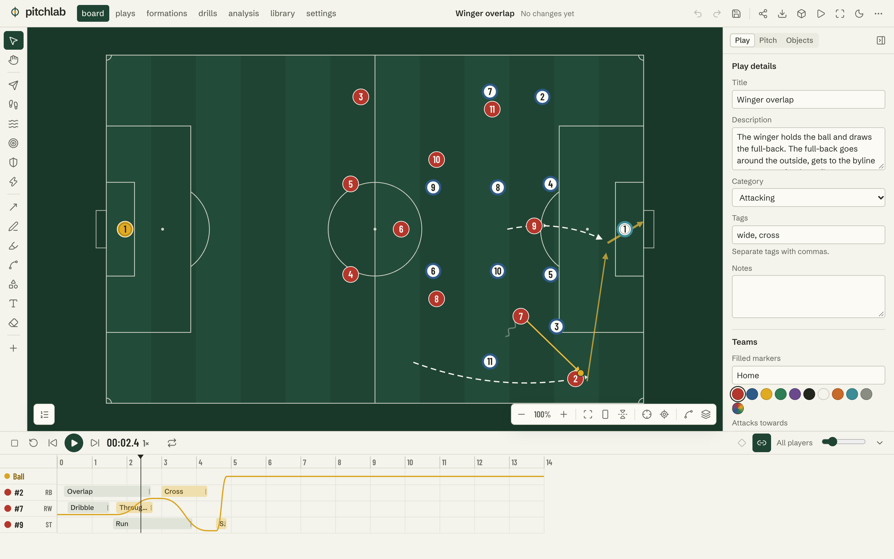
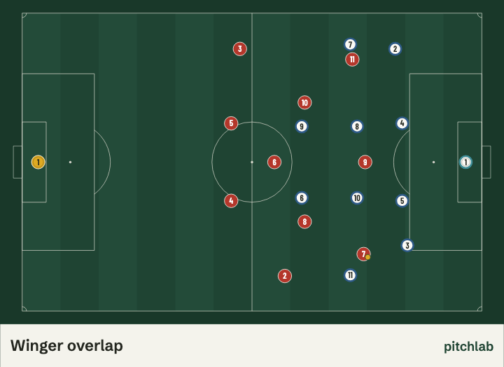
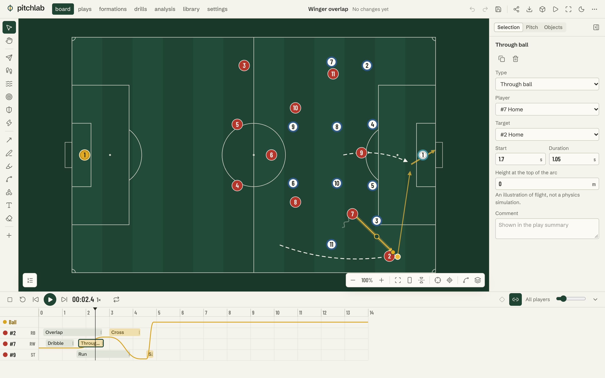
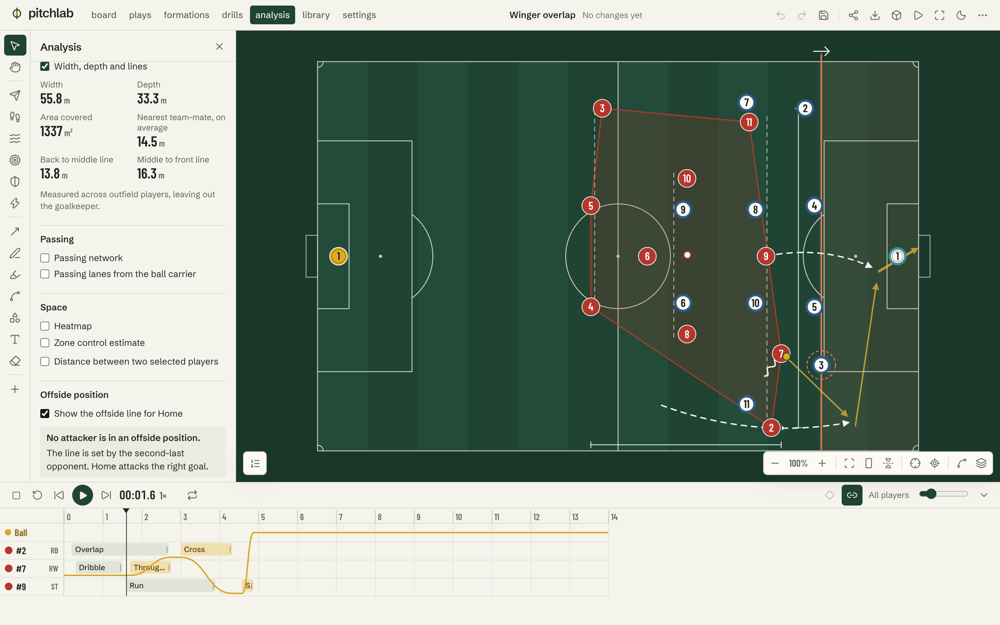
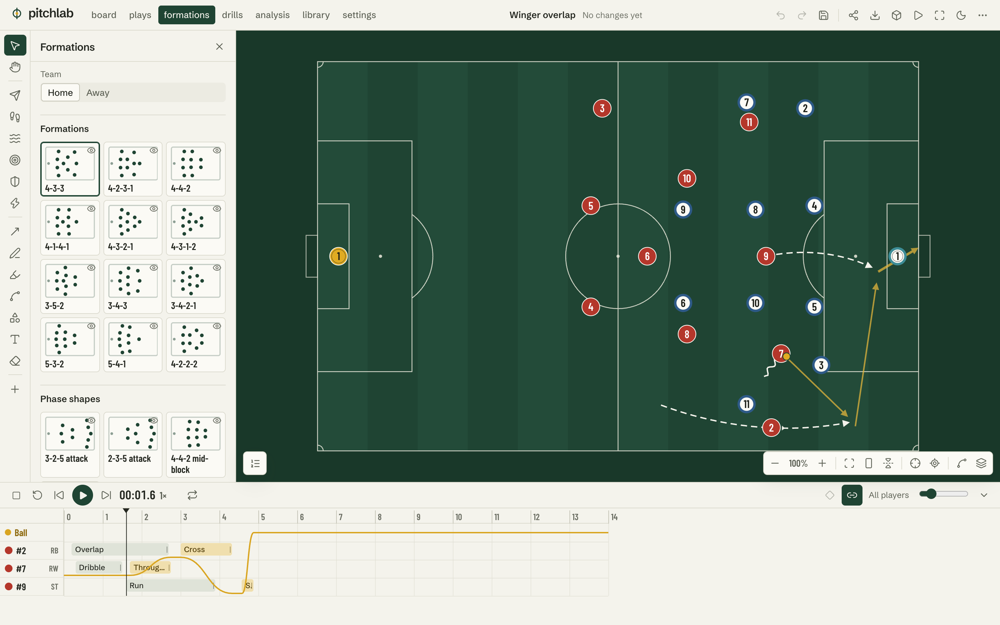
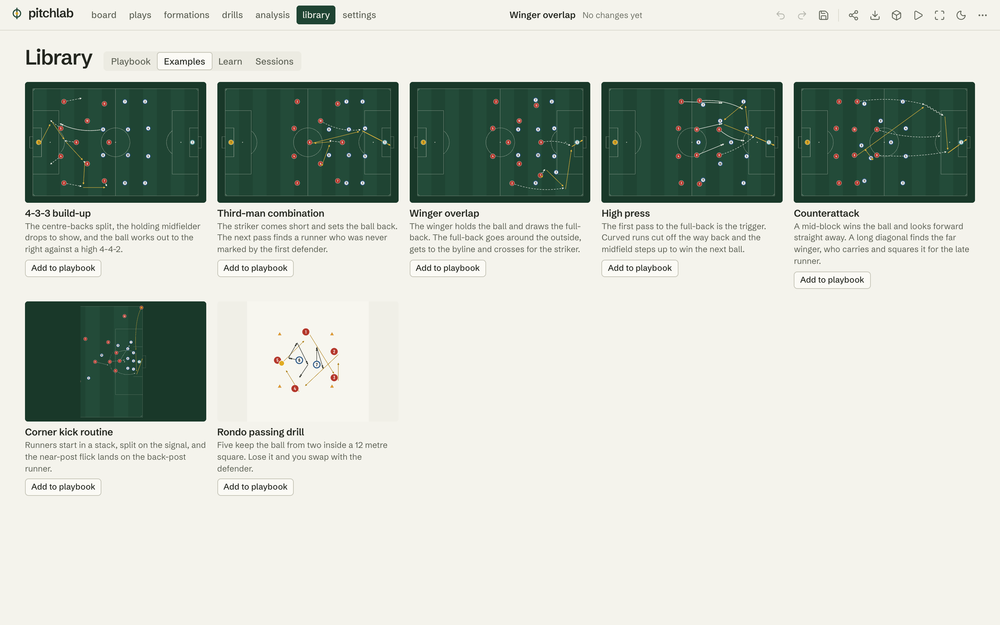
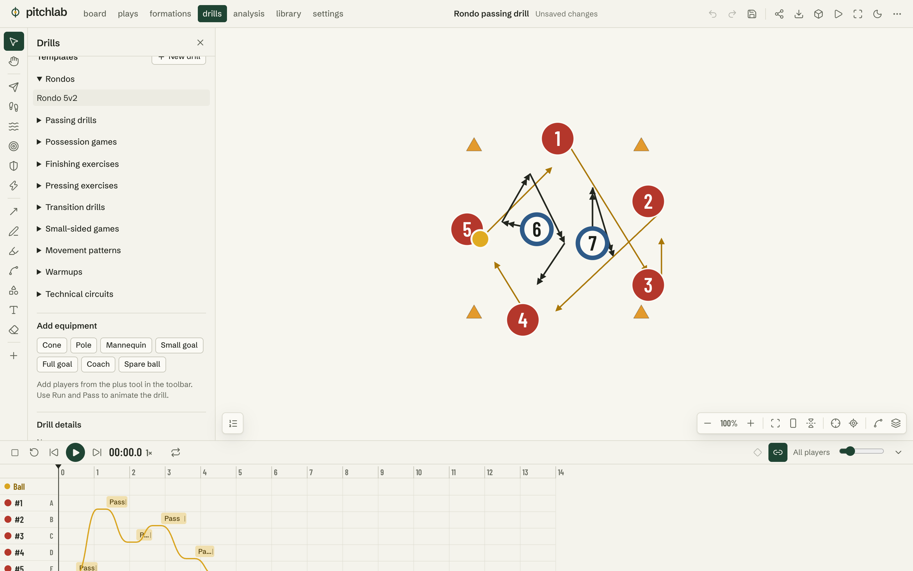
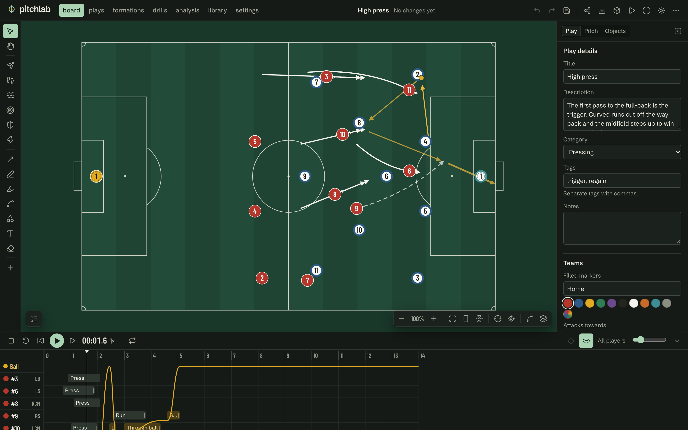
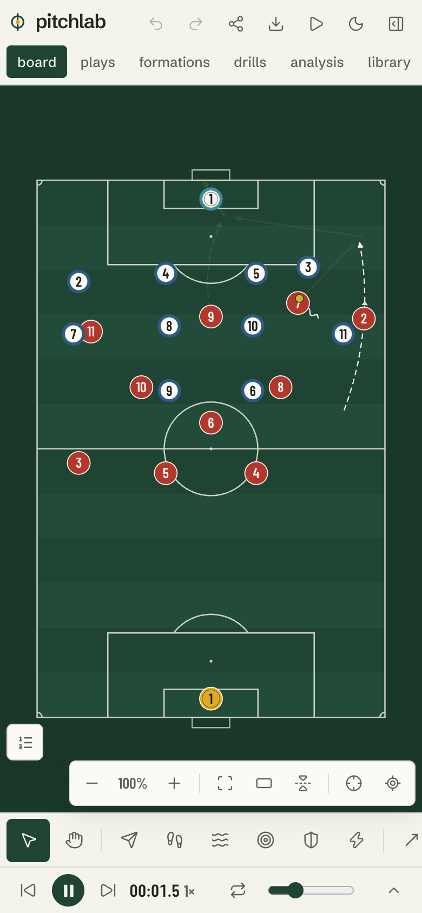

# pitchlab

A beautiful, interactive soccer tactics and coaching studio.

**Live Demo: [Open pitchlab](https://pitchlab-studio.vercel.app)**

**Source:** [github.com/yoonmax/pitchlab](https://github.com/yoonmax/pitchlab)



## Overview

pitchlab is a tactics board you can animate. Draw a pass or a run, press play, and watch the play happen. Scrub it, retime it on a timeline, analyse the shape it creates, and export it for a team talk. It needs no account: work is saved in your browser, and a play can be shared as a read-only link.



## Features

- **Board.** A pitch with correct Law 1 geometry, plus 9v9, 7v7, 5v5, custom sizes, half and third views and a blank canvas. Six pitch styles, and overlays for thirds, zones, channels, half-spaces and the five-lane grid.
- **Players and equipment.** Drag, multi-select, duplicate, lock, layer, copy and paste. Filled and ringed markers mean teams never rely on colour alone. Cones, poles, mannequins, goals and coaches.
- **Formations.** Twelve standard formations, phase shapes such as 3-2-5, and small-sided shapes. Switching keeps player identities and animates the change. Save, compare, import and export your own, or write a shape change into the timeline.
- **Tactical drawing.** Passes, through balls, crosses, shots, runs, overlaps, dribbles, presses and recoveries, plus arrows, freehand lines, highlights, zones, shapes and text. Strokes are fitted to smooth Bézier curves with draggable handles. Lines can attach to players and follow them.
- **Animated play designer.** A real timeline with clips, keyframes, grouping, alignment, snapping and interpolation. Playback runs from 0.25× to 4×, with looping and event stepping. A pass dropped along a team-mate's run arrives with them.
- **Possession.** The ball is always held, in flight, free or dead, never two at once. Passes, interceptions and tackles move it, and impossible events are flagged with a reason.
- **Play summary.** A readable account generated from the edited timeline.
- **Set pieces.** Ten templates for corners, free kicks, throw-ins, goal kicks, kick-offs and penalties, with a tool that places a wall 9.15 m from the ball.
- **Drills and sessions.** Templates for ten kinds of practice, full drill details, animated demonstrations, and session plans you can print.
- **Analysis.** Convex hull, width, depth, line spacing, passing networks, passing lanes, heatmaps, a zone-control estimate, player distances and an offside-position learning tool. All of it is calculated from your play or from a CSV or JSON file you import.
- **Library.** A searchable playbook with thumbnails drawn from each play, seven example plays, and fifteen illustrated lessons.
- **Export and sharing.** PNG, SVG, JSON, copy to clipboard, animated GIF, MP4 or WebM where the browser can encode it, and read-only share links.
- **3D replay.** Six camera views of the same timeline.
- **Accessibility and devices.** Light and dark themes, reduced-motion support, keyboard shortcuts you can rebind, an object list that works without the pitch, and a phone layout with touch drag and pinch zoom.

| | |
|---|---|
|  |  |
|  |  |
|  |  |



## Technology

JavaScript (ES2022) and JSX, React 19, Vite, Zustand, Immer, SVG, GSAP for interface motion, Three.js with React Three Fiber for the replay, IndexedDB for storage, gifenc and Mediabunny for animated export, Lucide icons. Vitest and Playwright for tests.

Tailwind is set up, but the design system is hand-written CSS tokens in `src/styles/index.css` and almost no utility classes are used.

## Architecture

```
src/
  core/        Pure logic with no React: the part most of the tests cover
    pitch/       geometry, camera maths, themes
    animation/   Bézier paths, easing, timeline compile and sample, playback
    tactics/     event types, play summary, analysis
    formations/  catalog and assignment
    storage/     IndexedDB, validation, migrations, share links, match import
    data/        examples, set pieces, drills and lessons, written as real documents
  state/       Editor store, playhead, actions, autosave, shortcuts
  board/       Live board, pointer handling, camera, and the shared drawing components
  ui/          Panels, inspector, timeline, library, settings, dialogs
  export/      Image and animation exporters (loaded on demand)
  replay/      3D view (loaded on demand)
```

### Document model

A play is one versioned JSON document with stable IDs: `pitch`, `teams`, `objects`, `annotations`, `events` and `ball`, plus `drill` details where relevant. Events are the only source of truth for what happens. A keyframe is a movement event whose start is implied by the previous arrival, so a player can never teleport.

### Timeline and animation

`compile(doc)` turns a document into movement segments and a ball state sequence. `sample(compiled, t)` reads the pose at any time and remembers nothing, so playing, pausing, scrubbing and every playback speed agree by construction. The board, thumbnails, exports and the 3D replay all read from these same functions.

During playback, the playhead writes positions straight to the SVG, and React does not re-render. In a headless Chromium run on an Apple Silicon Mac, writing one frame for a 22-player play cost about 0.025 ms, and two seconds of playback held a 16.7 ms median frame with layout forced each frame. That excludes paint time and is not a measurement of slower devices.

### Geometry and coordinates

World units are metres, with the origin at the top-left corner of the pitch. One camera (`cx`, `cy`, `zoom`, `rot`) converts between world and screen, and every pointer event goes through it, so dragging stays accurate at any zoom, pan or rotation. Pitch markings come from one list of primitives shared by the 2D board, exports and the 3D texture.

### Export

`StaticBoard` draws a document at a given time as a pure function, using the same marks as the live board. PNG and SVG embed the fonts. GIF and video step through the timeline at fixed times and render each frame, so they are frame-exact and do not record the screen.

### Saving and files

Autosave writes to IndexedDB once editing goes quiet. Every record and imported file passes through a validator that copies only known fields, range-checks values and drops broken references. Files are data, and nothing in them is executed. A migration step upgrades older schema versions. Share links compress the play into the URL fragment, which is never sent to a server.

## Getting started

```bash
npm install
```

```bash
npm run dev
```

The dev server runs at http://localhost:5220.

| Command | What it does |
|---|---|
| `npm run dev` | Start the development server |
| `npm run build` | Build for production into `dist` |
| `npm run preview` | Serve the production build on port 5221 |
| `npm run lint` | Run ESLint |
| `npm test` | Run the unit tests |
| `npm run test:e2e` | Build, then run the browser tests against the production build |

Adding `?debug` to the URL exposes `window.__pitchlab`, which the browser tests use.

## Testing

The most recent run had 331 unit tests and 51 browser tests passing, and ESLint clean.

- **Unit tests** cover pitch proportions and camera transforms, keyframes and deterministic playback, possession rules, formations, editing and undo, analysis geometry, offside, saving, migration, corrupt files and share links. Every bundled play, set piece, drill and lesson is also compiled and checked for impossible events.
- **Browser tests** use the production build in Chromium to drag players, draw with every tool, create passes, play, pause, scrub, save, reload, reopen, export, share, use the phone layout, and run an axe accessibility audit (WCAG A and AA) on eight screens in both themes.

The same editor and phone browser tests can run against a deployed site:

```bash
BASE_URL=https://pitchlab-studio.vercel.app npx playwright test e2e/editor.spec.js e2e/mobile.spec.js
```

README images come from the running app:

```bash
CAPTURE_DOCS=1 npx playwright test docs-capture
```

## Deployment

pitchlab is a static site with no backend or secrets. It is deployed to Vercel with the CLI, so pushing to a repository does not deploy it:

```bash
npx vercel deploy --prod
```

## Known limitations

- **Tested in Chromium only.** Safari, Firefox and real phones and tablets have not been tested. Touch was tested through Chromium's device emulation, and pinch zoom has not been tested on a real device.
- **Your work stays in one browser.** There is no sync between devices, and clearing site data removes saved plays. Export a backup for anything you want to keep.
- **No real-time collaboration.** Sharing is a read-only snapshot, and later edits do not change a link already shared. Very large plays are too long for a link, so send them as JSON.
- **Small-sided markings are defaults.** Pitch and goal sizes follow FA Handbook section 38. That document does not give interior markings for these formats, so penalty areas and marks are editable defaults. Check your league's rules.
- **Ball flight is an illustration,** not a physics simulation. Lofted balls show a height arc only.
- **Zone control is an estimate.** Each patch of pitch goes to the nearest player, ignoring speed, facing and the ball.
- **The offside tool is a learning aid, not a ruling.** It follows the wording of Law 11 in the IFAB Laws of the Game 2026/27 but uses player centres and cannot judge involvement in play.
- **Match import is basic.** It reads generic CSV and JSON columns and has no adapters for specific data providers. The bundled sample is synthetic.
- **The 3D replay shows position only.** Figures are simple shapes, annotations and lines are not drawn, and equipment is approximate.
- **Video export needs WebCodecs.** Browsers without it can still export GIF.

## License and acknowledgements

pitchlab is released under the [MIT License](LICENSE).

- [Schibsted Grotesk](https://github.com/schibsted/schibsted-grotesk) and [Barlow Condensed](https://github.com/jpt/barlow) are used under the SIL Open Font License 1.1.
- [GSAP](https://gsap.com/standard-license) is used under its standard no-charge license, and [Mediabunny](https://github.com/Vanilagy/mediabunny) under MPL-2.0.
- [Lucide](https://lucide.dev) icons are under the ISC license. React, Three.js, Zustand, Immer and gifenc are under the MIT license.
- Offside guidance follows the IFAB Laws of the Game 2026/27, and small-sided pitch and goal sizes follow FA Handbook section 38. pitchlab is not affiliated with either body.
